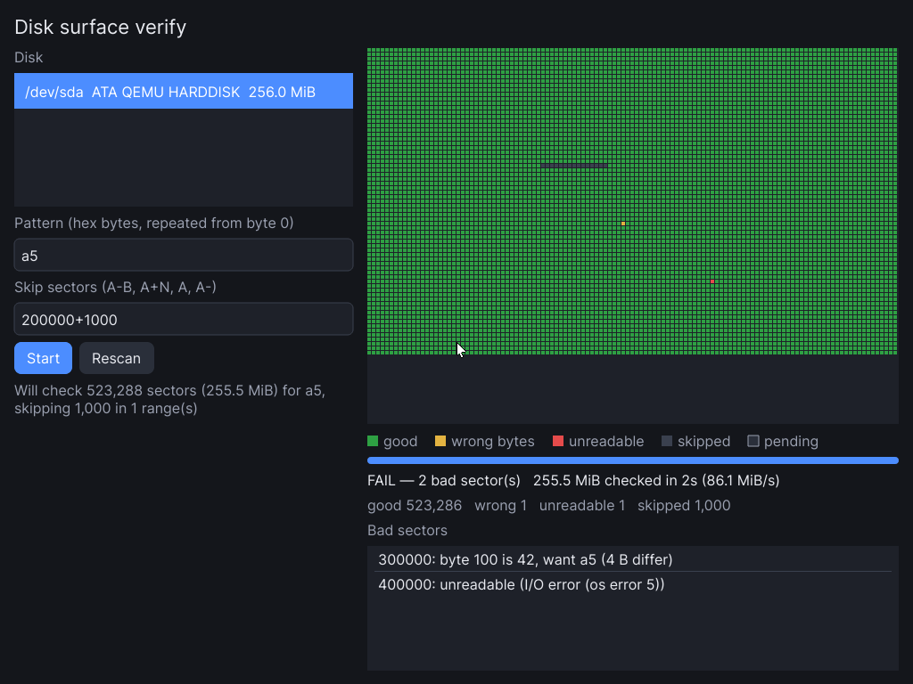

# disk-verify

An fbui example app: **verify that every sector of a disk holds an expected
byte pattern**, skipping the sector ranges you choose, with a live surface
map. It ships as a **bootable ISO** (BIOS and UEFI, CD or USB stick) that
boots straight into the app: no X11, no Wayland, no root filesystem.



*The ISO booted in QEMU (`scripts/qemu-smoke.py`) against a 256 MiB disk of
`a5` bytes with a planted corruption at sector 300000 and an injected read
error at sector 400000, skipping `200000+1000` (the grey bar).*

The scan is **read-only**: it never writes to the disk. Typical use is checking
a disk after it was wiped or filled with a known pattern (`dd if=/dev/zero`,
a vendor fill tool, a test rig that stamped `deadbeef`), or checking that a
batch of media reads back clean end to end.

## Using it

| Field | What to enter |
|---|---|
| **Disk** | Pick one. Whole block devices from `/sys/block` are listed (not RAM, loop or optical). Paths given on the command line (image files work) come first. **Rescan** picks up a newly plugged disk. |
| **Pattern** | Hex bytes, repeated across the whole disk **from byte 0**: byte `o` must equal `pattern[o % len]`, wherever the skips fall. `00` (or `zeros`) is a zeroed disk, `ff` (or `ones`), `de ad be ef` a 4-byte cycle. Spaces, `:` and `_` are ignored; up to 4096 bytes. |
| **Skip sectors** | Logical sectors (decimal or `0x` hex), separated by commas or spaces: `A` one sector, `A-B` inclusive, `A+N` N sectors from A, `A-` to the end. Overlaps merge. E.g. `0-2047, 1000000+4096` skips a partition table and a known-bad area. |

The line under **Start** says what will happen (`Will check 523,288 sectors
(255.5 MiB) for a5, skipping 1,000 in 1 range(s)`), or what's wrong with the
input. **Start** becomes **Stop** while a scan runs.

The **map** is the disk as a grid, left to right and top to bottom: green
good, amber wrong bytes, red unreadable, grey skipped, dark pending, with the
read head outlined. A cell shows the worst thing under it, so one bad sector
on a terabyte disk is still a visible cell. Below it are progress, throughput
and ETA, the totals, and the bad sectors: the first differing byte for a
wrong sector, the kernel's error for an unreadable one (the first 1000 are
listed, all are counted).

When a scan ends the status line reads `PASS — every checked sector matches`
or `FAIL — N bad sector(s)`.

**How it reads.** It reads 1 MiB at a time with `O_DIRECT` where the device
allows it, so the scan measures the media rather than the page cache. A chunk
that fails to read is retried one sector at a time, so a bad sector costs one
sector, not a megabyte. Each chunk is checked with a single compare against a
precomputed run of the pattern. The scan runs on a worker thread and reports
to the UI ten times a second through an `fbui::Proxy`.

## Running it

On a Linux machine with a free text VT (root, or `video` + `input` + `disk`
groups):

```sh
cargo run --release -p fbui-disk-verify            # lists /dev/sd*, /dev/nvme*, …
cargo run --release -p fbui-disk-verify -- disk.img  # or check an image file
```

`DISK_VERIFY_PATTERN` and `DISK_VERIFY_SKIP` preset the two fields. Esc quits.

With no screen, use the headless loop from `docs/tooling.md`;
`scripts/check-headless.sh` builds a 64 MiB image with one corrupted sector and
drives `flows/verify.txt` (two scans, skips, input validation) plus a lint
pass.

## The ISO

```sh
rustup target add x86_64-unknown-linux-musl
sudo apt install grub-pc-bin grub-efi-amd64-bin grub-common xorriso mtools \
    cpio busybox-static kmod zstd linux-image-generic   # Ubuntu/Debian names
apps/disk-verify/scripts/build-iso.sh                  # → target/disk-verify.iso
```

What goes in (about 32 MB with an Ubuntu 6.8 kernel):

- **the kernel** — the newest `/boot/vmlinuz-*` unless `KERNEL=` / `MODULES=`
  say otherwise. It needs `DEVTMPFS` and `SIMPLEDRM` (or `SYSFB_SIMPLEFB` + an
  fbdev driver) built in, which every mainstream distribution kernel has.
  GRUB boots it in a 1024×768 graphics mode (VBE on BIOS, GOP on UEFI), and
  simpledrm hands that framebuffer to fbui as a DRM device, so no GPU driver
  is needed. A second menu entry asks for 1280×800.
- **an initramfs** — static busybox, the app as a static musl binary (~4 MB:
  DRM, evdev, text shaping and the bundled font, no C libraries), the
  storage/input drivers the kernel builds as modules (AHCI/ATA, NVMe, USB
  storage/UAS, USB HID, PS/2 mouse, common virtual SCSI) with their
  dependencies, and `iso/init`.
- **`iso/init`** (PID 1) mounts `/proc`, `/sys`, `/dev`, loads drivers by
  modalias and from `iso/modules`, quiets the kernel log, and runs
  `disk-verify` on tty1 as its controlling terminal. After Esc the console is
  back in text mode with a menu: run again, shell, reboot or power off.

Write it to a USB stick with `dd if=target/disk-verify.iso of=/dev/sdX bs=4M`
(it is a hybrid image), or boot it as a CD.

### Trying it in QEMU

```sh
qemu-system-x86_64 -m 1024 -cdrom target/disk-verify.iso \
    -drive file=disk.img,format=raw,if=virtio    # add -bios /usr/share/ovmf/OVMF.fd for UEFI
```

`scripts/qemu-smoke.py ISO OUTDIR [--uefi]` does that unattended: it builds a
256 MiB `a5`-filled disk with one corrupted sector, injects a read error at
another through QEMU's `blkdebug`, boots the ISO with no display, types into
the UI over the QEMU monitor, and checks the surface map's pixels for both a
wrong-bytes cell and an unreadable cell. It writes `boot.png`, `done.png` and
`menu.png` (after Esc). CI runs it under both SeaBIOS and OVMF.

## Code

| File | What |
|---|---|
| `src/main.rs` | The `App`: layout, input validation, starting and stopping the scan thread, and turning reports into widget updates. |
| `src/scan.rs` | The scan: chunked reads, per-sector fallback on errors, compare, batched `Report`s. Generic over a `ReadAt`, so tests use a fake disk with unreadable sectors. |
| `src/ranges.rs` | The skip-list parser and the scan plan (its complement). |
| `src/pattern.rs` | Pattern parsing and the precomputed compare window. |
| `src/devices.rs` | Disk discovery from sysfs. |
| `src/map.rs` | `SurfaceMap` and `Swatch`, the app's custom widgets. |
